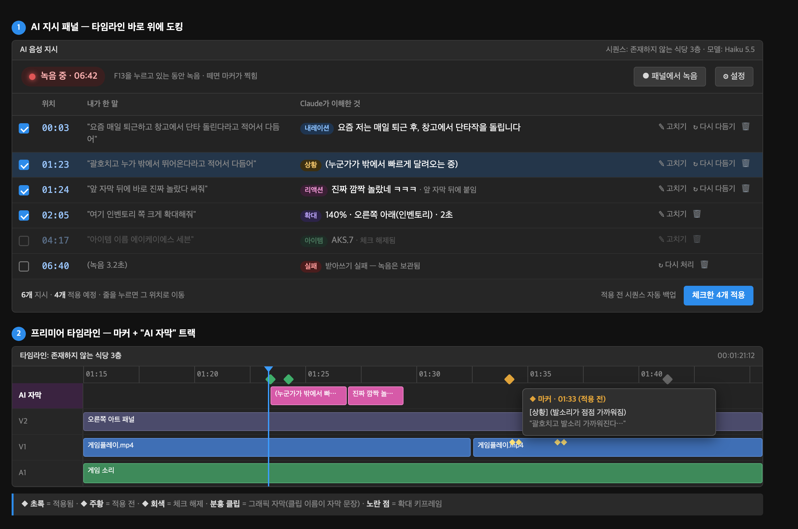

# 음성 지시 (Voice Orders) 설계

- 날짜: 2026-11-06
- 상태: 설계 승인 대기
- 시안: 

## 1. 목적

영상을 재생하며 보다가 단축키를 누르고 말로 편집 지시를 남긴다. 지시는 그 순간 위치에 마커로 쌓이고, 다 본 뒤 패널에서 검토하고 체크한 것만 한 번에 적용한다.

- **지시 종류(1차):** 자막, 확대. 나중에 컷·배속 같은 종류를 더하기 쉽게 만든다.
- **자막 스타일 기준:** 테나 채널 아레나 브레이크아웃 영상(youtu.be/iISEZGNqfL8)의 한 줄 자막.
- **성공 기준:**
  1. 재생을 멈추지 않고 지시를 남길 수 있다.
  2. 키를 뗀 뒤 1~3초 안에 목록에 해석 결과가 뜬다(목표치, 미측정).
  3. 적용 결과를 타임라인에서 다시 읽어 실제로 들어갔는지 확인하고, 일부만 들어가면 성공으로 숨기지 않는다(이 저장소의 검증 계약).

### 사용자가 정한 것

| 항목 | 결정 |
|---|---|
| 녹음한 목소리 | 버린다. 받아쓰기에만 쓰고 영상에는 다듬은 글자만 넣는다 |
| 녹음 시작 | 전역 단축키(누르는 동안 녹음) + 패널 버튼 둘 다 |
| 적용 시점 | 보는 동안은 마커만. 다 본 뒤 패널 검토 → "적용" |
| 검토 기본값 | 모든 지시가 체크된 채로 나오고, 뺄 것만 체크를 푼다 |
| 자막 방식 | 그래픽 자막(MOGRT)을 "AI 자막" 전용 트랙에 넣는다 |
| 확대 | 기본값 + 말로 바꾸기 |
| 다듬기 모델 | Claude Haiku 5.5로 시작, 설정에서 Sonnet 5.5로 바꿀 수 있음 |

### 가정 (사용자 확인 전)

- 기존 `~/Library/Application Support/Adobe/Common/Motion Graphics Templates/1말하는자막.mogrt`가 AE에서 만든 템플릿이면 그대로 쓴다. 아니면 AE 2026으로 새로 만든다.
- 단축키 기본값은 `F13`.

## 2. 말 해석 규칙

녹음 한 번 = 지시 한 개 이상. 받아쓴 문장에서 **내용**과 **지시 문구**를 나눈다. "확대하고 ~ 자막도 넣어줘"처럼 지시가 둘 이상이면 같은 위치의 지시 여러 개로 나눠 목록에 각각 넣는다. 지시 문구는 정확히 아래 말이 아니어도 뜻이 같으면 알아듣는다.

| 말에 들어 있는 것 | 결과 |
|---|---|
| "~라고 적어서 다듬어" 또는 지시 문구 없음 | 자막 · 내레이션(과거형, 이야기하듯) |
| "괄호치고 ~" | 자막 · 상황 설명 `( … )` |
| 감탄·웃음 위주의 짧은 말 | 자막 · 리액션 (`ㅋㅋㅋ` 등 허용) |
| "아이템 이름 ~" | 자막 · 아이템 라벨 (이름만, 예: `AKS.7`) |
| "앞 자막 뒤에 바로" | 위치를 재생헤드 대신, 타임라인에서 그 위치 바로 앞에 있는 자막의 끝으로 (말한 순서가 아니라 타임라인 기준) |
| "확대해줘" (+ "크게", "3초", "왼쪽 위", "인벤토리 쪽") | 확대 지시 |

Claude는 구조화 출력(JSON 스키마)으로 `{"orders": [ … ]}` 배열을 돌려주고, 각 항목은 아래 형태 중 하나다.

```json
{"kind": "caption", "style": "narration|situation|reaction|item",
 "text": "다듬은 자막", "placement": "playhead|after_previous"}
{"kind": "zoom", "scale": 120,
 "anchor": "center|top_left|top|top_right|left|right|bottom_left|bottom|bottom_right",
 "holdSec": 2}
```

말투 예시(few-shot)는 시스템 프롬프트에 고정하고 프롬프트 캐시를 건다.

### 게임 용어 사전

- 파일 하나(`voice-orders/glossary.json`, 프로젝트와 무관하게 사용자 전역)에 `{"표기": ["들리는 말1", "들리는 말2"]}` 형태로 둔다. 예: `{"AKS.7": ["에이케이에스 세븐", "에이케이 세븐"]}`.
- 받아쓰기: 표기 목록을 Whisper `initial_prompt`로 넘기고, 받아쓴 뒤 "들리는 말 → 표기" 치환을 한 번 더 한다.
- 다듬기: 사전 전체를 시스템 프롬프트의 캐시 구간에 넣어 Claude가 표기를 그대로 쓰게 한다.
- 검토 화면에서 자막 글자를 고치면 "사전에 추가" 버튼을 띄운다(받아쓴 말 → 고친 표기). 누를 때만 추가한다.

## 3. 구성 요소

```
[F13 누름] ─ 녹음 ─ [F13 뗌]
      │  (누른 순간의 재생헤드 위치 함께 전달)
      ▼
① 단축키 도우미 (macOS 메뉴바 앱)
      │  WAV 경로 + 시각  →  로컬 소켓
      ▼
② 지시 패널 (기존 CEP 패널에 탭 추가, Node 사용 가능)
   ├─ ③ 받아쓰기 워커: faster-whisper small, 패널이 켜져 있는 동안 상주
   ├─ ④ 해석기: Claude API (구조화 출력)
   ├─ 지시 저장소: 프로젝트별 JSON (녹음 파일 경로 포함)
   └─ ⑤ 적용기: ExtendScript — 마커 / 그래픽 자막 / 확대 키프레임, 적용 후 재조회
```

| 부품 | 하는 일 | 의존 |
|---|---|---|
| ① 단축키 도우미 | 전역 단축키 감지, 마이크 녹음, 누른 순간 알림 | macOS 마이크·입력 모니터링 권한 |
| ② 지시 패널 | 목록 표시, 체크·고치기·다시 다듬기·삭제, 적용 버튼, 패널 녹음 버튼 | CEP(`--enable-nodejs`, 이미 켜짐) |
| ③ 받아쓰기 워커 | WAV → 한국어 문장 | `scripts/whisper_transcribe.py`의 환경 재사용 |
| ④ 해석기 | 문장 → 지시 JSON | Anthropic API 키, `@anthropic-ai/sdk` |
| ⑤ 적용기 | 마커 생성·갱신, MOGRT 배치·문구 설정·클립 이름, 확대 키프레임, 백업, 재조회 | 기존 브릿지·`set_clip_motion`·`backup_sequence` 로직 |

**재생헤드 위치:** 패널이 단축키 "누름" 신호를 받는 즉시 `getPlayerPosition()`을 읽어 지시에 고정한다. 재생 중에 말해도 말을 시작한 지점이 기준이다.

**주된 사용 방식:** 사용자는 주로 멈춘 뒤 재생바나 방향키로 정확한 프레임에 맞추고 말한다. 재생바를 뒤로 돌려 말해도 그때의 재생헤드 위치가 기준이다.

**단축키 도우미가 따로 필요한 이유:** CEP 패널은 자기에게 포커스가 있을 때만 키 입력을 받는다. 타임라인을 보며 누르려면 전역 단축키가 필요하다.

## 4. 데이터 흐름

1. 누름 → 패널이 재생헤드 위치 기록, 마커 생성(`처리 중`, 주황).
2. 뗌 → 도우미가 WAV 저장 후 경로 전달 → 목록에 줄 추가(`처리 중`).
3. 받아쓰기 → 해석 → 목록 줄과 마커 이름·설명을 해석 결과로 갱신.
4. 사용자가 검토(체크 해제·고치기·다시 다듬기·삭제·**시간 고치기**). 줄을 누르면 재생헤드가 그 위치로 이동. 목록은 말한 순서가 아니라 **영상 시간 순서**로 정렬하고, 시간을 고치면 마커도 함께 옮긴다. 같은 위치의 지시가 여럿이어도 모두 남긴다.
5. "적용" → 시퀀스 백업 → 체크한 지시를 시간순으로 적용 → 재조회 → 줄마다 결과 표시, 마커 초록으로.

## 5. 적용 세부

**자막**
- 대상 트랙: "AI 자막" 트랙. 트랙 위치는 프로젝트별 설정에 저장하고, 없으면 맨 위에 빈 비디오 트랙을 만든다. 스크립트로 트랙 이름 변경이 안 되면 사용자에게 한 번 이름을 붙여 달라고 안내한다(구현 중 확인).
- 배치: `importMGT` 후 **재조회로 새 클립 탐지**(반환값이 null이어도 배치되는 알려진 동작), `getMGTComponent()` 텍스트 파라미터에 문구 설정, 클립 이름 = 자막 문장.
- 길이: 글자 수 기준, 최소 1.5초·최대 5초, 다음 자막 시작 전에 끝냄.

**확대**
- 대상: 그 위치의 가장 아래 비디오 트랙 클립(게임 화면).
- 기본값: 가운데 기준 120%, 0.3초 들어감 → 유지 2초 → 0.3초 나옴, 베지어 보간.
- 기존 `set_clip_motion`의 시간 변환(미디어 시간 기준)을 그대로 쓴다.

**마커 색:** 주황 = 적용 전, 초록 = 적용됨, 회색 = 체크 해제.

**재생 중 마커 생성:** 재생 중에 스크립트로 마커를 만들면 재생이 멈추는지 아직 모른다. 구현 첫 단계에서 확인하고, 멈춘다면 마커는 재생을 멈춘 순간 한꺼번에 찍고, 그 전까지는 패널 목록에만 쌓는다.

## 6. 오류 처리

| 상황 | 처리 |
|---|---|
| 받아쓰기 실패 | 줄을 `실패`로 남기고 녹음 보관, "다시 처리" 제공 |
| Claude 호출 실패(오프라인·한도) | 받아쓴 문장을 그대로 넣고 `다듬기 안 됨` 표시, 나중에 "다시 다듬기" |
| 거절(`stop_reason: refusal`) | `다듬기 안 됨`과 같게 처리 |
| 적용 중 일부 실패 | 실패한 줄만 표시하고 전체를 `부분 실패`로 보고. `success: true`로 숨기지 않음 |
| 브릿지 꺼짐 | 패널 상단에 "Start Bridge 필요" 표시, 녹음·해석은 계속 쌓임 |

## 7. 테스트

- **해석기:** 위 2장의 표 각 행마다 예시 문장(최소 20개, 두 가지 지시를 섞은 문장 포함)으로 지시 개수와 `kind`·`style`·`placement`를 검사하는 자동 테스트.
- **용어 사전:** 치환 함수 단위 테스트, 사전 추가 후 같은 말이 표기로 바뀌는지 확인. 실제 API 호출 테스트는 비용이 들어서 따로 실행한다.
- **자막 길이·위치 계산:** 순수 함수로 분리해 단위 테스트.
- **적용기:** 테스트용 복사 시퀀스에 자막 3개·확대 1개를 넣고 재조회로 개수·시작 시각·키프레임 확인(26.5.2 정식판).
- **실사용:** 11분 게임 영상에서 지시 20개 이상을 남기고 적용한 뒤 재생이 끊기지 않는지 확인.

## 8. 2차 후보 (1차가 실사용에서 잘 돌아간 뒤 검토)

| 지시 | 내용 | 미룬 이유 |
|---|---|---|
| 컷 | "여기서부터 3초 잘라줘" — `apply_timeline_removals` 재사용 | 뒤쪽 자막·마커가 밀리므로 적용 순서 설계가 필요 |
| 효과음 | "여기 띠용 효과음" — 효과음 폴더에서 이름으로 찾아 오디오 트랙에 배치 | 효과음 라이브러리를 먼저 갖춰야 함 |
| 배속 | "여기부터 여기까지 2배속" | `premiere-dub-edit` 스킬과 역할 정리 필요 |
| 콜드오픈 | "이 장면 맨 앞에 붙여줘" — `insert_clip` 재사용 | 1차 범위 축소 |

## 9. 범위 밖 (하지 않음)

- 화면을 보고 확대 위치를 고르는 기능
- 유튜브용 SRT 내보내기(필요하면 AI 자막 트랙을 읽어 따로 만든다)
- Windows 지원
